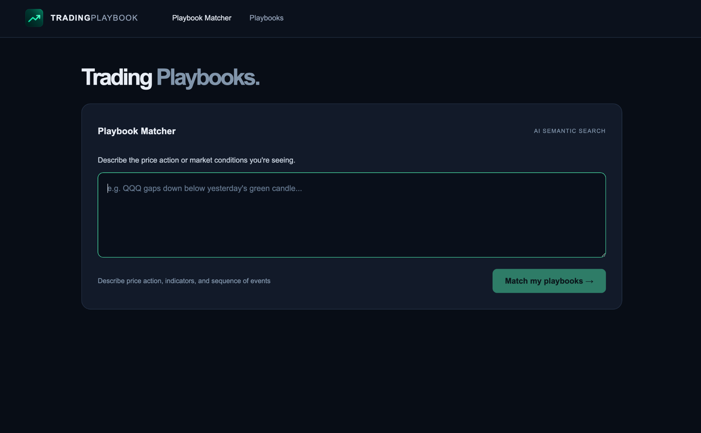
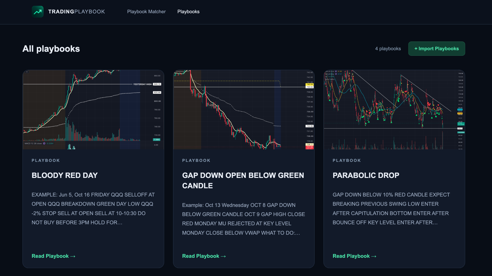
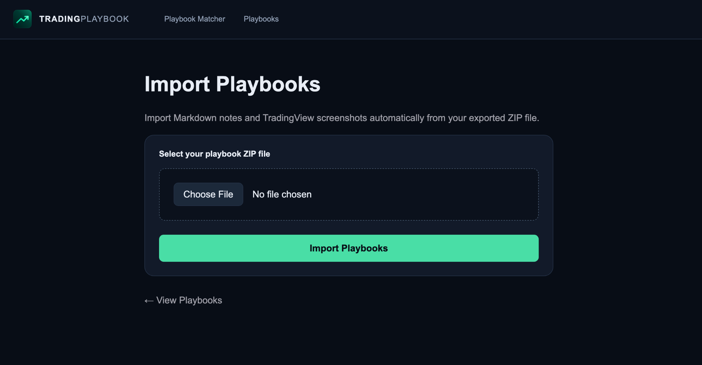

# Trading Playbook

A personal, local-first web app for organizing trading playbooks and matching market descriptions to relevant trading notes using AI semantic search.

## Features

- **Playbook Matcher:** Describe market conditions in plain English and find similar playbooks.
- **Local semantic search:** Uses Transformers.js and the `Xenova/all-MiniLM-L6-v2` embedding model. No OpenAI API key is needed.
- **Playbook library:** Browse Markdown trading notes with chart thumbnails.
- **Playbook details:** Read the original Markdown and view TradingView chart screenshots.
- **ZIP import:** Import Markdown notes and their attached images.
- **Delete playbooks:** Manage the local library from the app.

Similarity scores reflect text similarity, **not** trading probabilities or recommendations.

## Screenshots

### Playbook Matcher

Describe market conditions and find related trading playbooks with local AI semantic search.



### Playbook Library

Browse your trading playbooks with original TradingView chart thumbnails and note previews.



### Import Playbooks

Import exported Markdown notes and their attached screenshots from a ZIP file.



## Tech stack

- Next.js (App Router)
- React and TypeScript
- CSS Modules
- Transformers.js
- Markdown files stored locally

## Getting started

### Prerequisites

- Node.js and npm

### Install and run

```bash
npm install
npm run dev
```

Open [http://localhost:3000](http://localhost:3000).

The first semantic search may take longer while the embedding model is downloaded and initialized.

## How to use

1. Open **Playbook Matcher** and describe the price action or market conditions you see.
2. Review the ranked matches, then open a playbook to read the original trading rules and charts.
3. Visit **Playbooks** to browse your existing notes.
4. Use **Import Playbooks** to add Markdown notes and images from a ZIP archive.

## Project structure

```text
app/
  page.tsx                # Playbook Matcher
  actions.ts              # Search Server Action
  playbooks/
    page.tsx              # Playbook library
    [slug]/page.tsx       # Playbook detail
  import/                 # ZIP importer
components/               # Shared UI such as Navbar
lib/
  playbooks.ts            # Read local Markdown playbooks
  semantic-search.ts      # Embeddings and similarity ranking
  import-playbooks.ts     # ZIP import logic
playbooks/                # Markdown notes
public/charts/            # Imported chart screenshots
```

## Future improvements

- OpenAI-powered matching and explanations
- Better ranking of exact-title matches and trading-specific conditions

## Disclaimer

This is a personal trading journal and research tool, not financial advice or an automated trading system.
